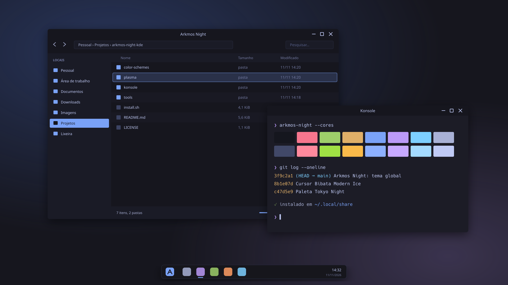

# Arkmos Night

Tema global escuro para o KDE Plasma 6, com a paleta do [Tokyo Night](https://github.com/folke/tokyonight.nvim) e o cursor [Bibata Modern Ice](https://github.com/ful1e5/Bibata_Cursor), o mesmo do [Arkmos](https://github.com/AlexRogaleski/arkmos).



<sub>A imagem é uma ilustração da paleta, não uma captura de tela.</sub>

## O que vem no tema

| Parte | O que é |
|---|---|
| Esquema de cores | `Arkmos Night`: janelas `#1a1b26`, listas e barras `#16161e`, texto `#c0caf5`, seleção azul `#7aa2f7` |
| Estilo do Plasma | `Arkmos Night`: painel, popups e widgets com as cores do tema |
| Tema global | Junta tudo e também define o cursor e a tela de abertura |
| Tela de abertura | O nome sobre o fundo do Tokyo Night, com uma barra de progresso |
| Cursor | Bibata Modern Ice 2.0.7, baixado do release oficial com SHA256 conferido |
| Konsole | Esquema `Arkmos Night` com as 16 cores do terminal do Tokyo Night |

Os desenhos (formatos de botões, painel e decoração das janelas) são os do Breeze, que já vem no Plasma. O estilo do Plasma tem só o arquivo de cores; o que falta, o Plasma pega do Breeze, como faz o próprio Breeze Dark. Assim nenhum arquivo do Breeze é copiado para cá e as atualizações do Plasma continuam valendo.

## Instalação

Precisa do Plasma 6. Tudo vai para `~/.local/share`, sem `sudo`, e funciona em sistemas imutáveis como Bazzite e Fedora Kinoite.

```sh
git clone https://github.com/AlexRogaleski/arkmos-night-kde.git
cd arkmos-night-kde
./install.sh --apply
```

| Opção | Efeito |
|---|---|
| (nenhuma) | Instala, mas não aplica |
| `--apply` | Instala e aplica o tema global |
| `--no-cursor` | Não baixa o cursor |

Sem `--apply`, escolha o tema em **Configurações do sistema → Cores e temas → Tema global → Arkmos Night**. Aplicar o tema não mexe no seu painel nem nos widgets, a menos que você marque a opção de layout da área de trabalho nessa tela.

### Cor de destaque

Se você escolheu uma cor de destaque em **Cores e temas → Cores**, ela passa por cima do azul do tema. O `install.sh` avisa quando isso acontece. Para usar a cor do tema, marque **Do esquema de cores** nessa tela.

### Konsole

O Konsole não segue o tema global. Para usar as cores, vá em **Configurações → Editar perfil atual → Aparência** e escolha **Arkmos Night**.

### Tamanho do cursor

O Bibata tem os tamanhos 16, 20, 22, 24, 28, 32, 40, 48 e acima. Com outro tamanho, o KDE usa o mais próximo, e o cursor pode ficar um pouco menos nítido.

## Remoção

```sh
./uninstall.sh
```

O que estiver em uso volta para o Breeze Dark antes de ser apagado. O cursor fica instalado, porque outros temas podem usar; para tirar, apague `~/.local/share/icons/Bibata-Modern-Ice`.

## Mudando as cores

A paleta fica só em `tools/build.py`. Altere lá e gere os arquivos de novo:

```sh
python3 tools/build.py
./install.sh --apply
```

O script gera o esquema de cores, as cores do Plasma, o esquema do Konsole e as prévias. As prévias precisam do ImageMagick (`magick`).

## Paleta

| Uso | Cor |
|---|---|
| Fundo das janelas | `#1a1b26` |
| Listas, barras de título, painel | `#16161e` |
| Botões | `#292e42` |
| Texto | `#c0caf5` |
| Texto apagado | `#737aa2` |
| Seleção, foco, links | `#7aa2f7` |
| Links visitados | `#bb9af7` |
| Erro | `#f7768e` |
| Aviso | `#e0af68` |
| Sucesso | `#9ece6a` |

## Créditos

- Paleta: [Tokyo Night](https://github.com/enkia/tokyo-night-vscode-theme), de enkia, na versão de [folke/tokyonight.nvim](https://github.com/folke/tokyonight.nvim).
- Cursor: [Bibata](https://github.com/ful1e5/Bibata_Cursor), de ful1e5 (GPL-3.0). Ele é baixado na instalação; não é distribuído neste repositório.
- Desenhos de interface: Breeze, do KDE Visual Design Group, que já vem com o Plasma.

## Licença

MIT. Veja [LICENSE](LICENSE).
